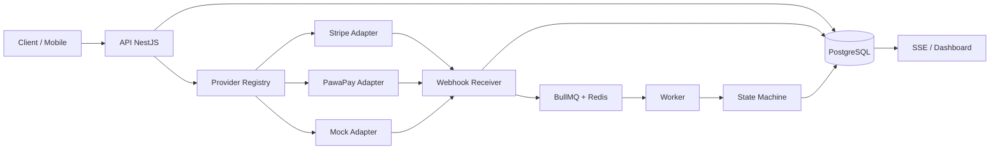

# Payment Gateway Showcase

A working multi-provider payment gateway demo: **Stripe**, **PawaPay** and a
zero-key **Mock** rail behind one adapter contract.

The Mock rail is the default. It requires no external account, signs its own
webhooks and exercises the exact same PostgreSQL inbox, BullMQ queue, worker and
state machine as the real providers.

- Web: `http://localhost:4310/fr` (ou `/en`)
- API: `http://localhost:3001/api/v1`
- Swagger: `http://localhost:3001/docs`

## What it demonstrates

- **Buyer-grade checkout**: real product pages, regional catalog, progressive checkout, mobile sticky CTA, shopper-first result page.
- **Bilingual**: French and English routes with locale-aware money and dates.
- **Hidden rails**: buyers choose Card, Mobile money or Demo; the provider is resolved internally.
- **Under the hood**: API calls, events, webhooks and state machine in a developer drawer.

- **Strategy pattern** for payment providers (`mock`, `stripe`, `pawapay`).
- **Signed webhooks** verified on the raw body before any write.
- **Inbox pattern**: the event is persisted in PostgreSQL before BullMQ sees it.
- **Idempotency** at the client, provider-event and state-transition levels.
- **Concurrency safety**: `SELECT … FOR UPDATE`, one transition, one credit.
- **Explicit state machine** shared between API and UI.
- **Money as minor units** with currency, never floats.
- **Server-side pricing** resolved from the catalog, never from the client.
- **SSE** for live payment status in the checkout.
- **Swagger** generated from NestJS DTOs at `/docs`.
- **Zero-key demo** with a signed mock provider and seeded dashboard data.
- **Stripe Checkout** in test mode with signed `checkout.session` / `payment_intent` webhooks.
- **PawaPay deposits** in sandbox with final-state callbacks and RFC 9421 verification.
- **Reconciliation worker** for providers that only notify on final status.

## Stack

| Layer       | Choice                                                              |
| ----------- | ------------------------------------------------------------------- |
| Monorepo    | pnpm workspaces + Turborepo, Node 24                                |
| API         | NestJS 12, TypeScript strict, Swagger                               |
| Persistence | PostgreSQL 18, Drizzle ORM, UUIDv7                                  |
| Async       | Redis 7, BullMQ 6                                                   |
| Web         | Next.js 16 App Router, React 19, Tailwind 4, TanStack Query         |
| Tests       | Vitest (unit) + Playwright (E2E) + race script; Testcontainers next |

## Quickstart

```bash
pnpm install
docker compose up -d postgres redis
pnpm db:migrate
pnpm db:seed
pnpm dev
```

Then open:

- `http://localhost:4310/fr` — landing page (bilingue FR/EN)
- `http://localhost:4310/fr/shop` — real-product storefront
- `http://localhost:4310/fr/checkout` — buyer checkout (Mock by default)
- `http://localhost:4310/fr/dashboard` — inspect transactions and webhooks
- `http://localhost:3001/docs` — Swagger

No `.env` is required locally: safe demo defaults are built in. Copy
`.env.example` to `.env` if you want to override them. The API and worker load
the root `.env` in development.

## Configuring real providers

Stripe and PawaPay stay disabled until their credentials are present. The UI
reads `/providers` and only enables configured rails. Restart `pnpm dev` after
changing provider credentials.

### Stripe test mode

```bash
STRIPE_SECRET_KEY=sk_test_...
STRIPE_WEBHOOK_SECRET=whsec_...
WEB_URL=http://localhost:4310
```

Forward webhooks locally with the Stripe CLI:

```bash
stripe login
stripe listen --forward-to localhost:3001/api/v1/webhooks/stripe
```

Use the `whsec_...` secret printed by the CLI. Stripe Checkout hosts the card
fields; no PAN reaches this API. Test card: `4242 4242 4242 4242`, any future
expiry, any CVC. If you skip the CLI, the reconciliation worker still picks up
the completed Checkout Session after a couple of minutes.

### PawaPay sandbox

```bash
PAWAPAY_API_TOKEN=...
PAWAPAY_BASE_URL=https://api.sandbox.pawapay.io
PAWAPAY_DEFAULT_COUNTRY=SN
PAWAPAY_ALLOW_UNSIGNED_CALLBACKS=false
```

Configure the callback URL `https://<your-api>/api/v1/webhooks/pawapay` in the
PawaPay sandbox dashboard. Enable **signed callbacks** to get RFC 9421
verification; the adapter fetches PawaPay public keys from `/v2/public-key/http`
(you can also pin one with `PAWAPAY_PUBLIC_KEY`).

Sandbox test number for a completed Orange Senegal deposit: `221773456789`.
Use the XOF catalog product. PawaPay only sends final-status callbacks, so the
worker reconciles pending deposits every 60 seconds as a safety net. For local
callbacks, expose the API with a tunnel (ngrok, cloudflared, etc.); otherwise the
reconciliation poll still resolves the deposit.

For local sandbox experiments where signed callbacks are not enabled, set
`PAWAPAY_ALLOW_UNSIGNED_CALLBACKS=true`. Never do this in production. Outgoing
PawaPay request signing ("Only accept signed requests") is not enabled; leave
that dashboard option off.

### One-command demo

```bash
docker compose up --build
```

This starts PostgreSQL, Redis, migrations + seed, the API, the worker and the
web app. The first build downloads dependencies and takes a few minutes.

> The web app uses port `4310` to avoid the very common `3000` conflict.
> If needed, change the `web` script, the Compose port mapping and `CORS_ORIGIN`.

## Demo walkthrough

1. Open `/dashboard`: seeded mock transactions are visible.
2. Open `/checkout`, pick **Portfolio Pro**, **Mock** and **Card**.
3. Submit: the API creates a `PENDING` payment with a signed mock callback action.
4. Click **Approve payment**. The mock provider sends a signed webhook to
   `POST /webhooks/mock`.
5. Watch the status move to `SUCCEEDED` over SSE.
6. Inspect the event timeline and the raw webhook inbox in `/dashboard`.
7. Replay the same webhook: it is absorbed by the unique constraint; no second
   transition is written.
8. Run the concurrency check:

   ```bash
   pnpm test:race
   ```

   It creates a payment, sends 50 distinct signed success webhooks in parallel
   and asserts exactly one `PAYMENT_SUCCEEDED` transition and 50 inbox rows.

## API

| Method | Path                            | Purpose                                                     |
| ------ | ------------------------------- | ----------------------------------------------------------- |
| `GET`  | `/api/v1/products`              | Active server-side catalog                                  |
| `GET`  | `/api/v1/providers`             | Configured rails and capabilities                           |
| `POST` | `/api/v1/payments`              | Create a payment (`x-demo-key`, optional `Idempotency-Key`) |
| `GET`  | `/api/v1/payments`              | List with `status`, `provider`, `limit`, `cursor`           |
| `GET`  | `/api/v1/payments/:id`          | Payment detail                                              |
| `GET`  | `/api/v1/payments/:id/timeline` | Append-only event timeline                                  |
| `GET`  | `/api/v1/payments/:id/webhooks` | Raw webhook inbox rows                                      |
| `GET`  | `/api/v1/payments/:id/stream`   | SSE status stream                                           |
| `POST` | `/api/v1/payments/:id/simulate` | Signed mock webhook (`succeeded`, `failed`, `expired`)      |
| `POST` | `/api/v1/webhooks/:provider`    | Provider callback endpoint                                  |
| `GET`  | `/api/v1/health`                | Database + queue snapshot                                   |
| `GET`  | `/api/v1/health/live`           | Liveness                                                    |
| `GET`  | `/api/v1/health/ready`          | Readiness                                                   |

Mutation endpoints accept either `x-demo-key: <key>` or
`Authorization: Bearer <key>`. Swagger documents both the demo key header and
the `Idempotency-Key` header.

## Architecture



### Webhook flow

```text
POST /webhooks/:provider
  → verify signature on the raw body
    · mock: HMAC-SHA256 + timestamp window
    · stripe: Stripe-Signature via the official SDK
    · pawapay: RFC 9421 ECDSA P-256 + Content-Digest
  → INSERT webhook_events ON CONFLICT DO NOTHING
  → enqueue BullMQ (jobId = webhook event id)
  → 200
  → worker: SELECT … FOR UPDATE payment
  → validate amount / currency / transition
  → UPDATE payments + INSERT payment_events + mark processed_at
```

Unsupported provider events are acknowledged with `200` and ignored, so the
provider does not retry them forever. If Redis is unavailable after the insert,
the request still returns `200` and a sweeper re-enqueues unprocessed rows.
A reconciliation job also polls Stripe Checkout sessions and PawaPay deposits
that have been pending for more than two minutes.

### State machine

```text
CREATED ─┬→ PENDING ─┬→ REQUIRES_ACTION ─┐
         │            ├→ PROCESSING ──────┤
         │            └→ SUCCEEDED        │
         ├→ FAILED / EXPIRED / CANCELED ←─┘
         └→ PROCESSING

SUCCEEDED → REFUND_PENDING → PARTIALLY_REFUNDED → REFUNDED
```

The source of truth is `packages/contracts/src/domain.ts`. Backwards
transitions are rejected, terminal states are never overwritten and duplicate
events are no-ops.

### Data model

- `products` — server-side price catalog.
- `payments` — aggregate, current status, `version`, `last_event_at`.
- `payment_events` — append-only journal, one sequence per payment.
- `webhook_events` — raw inbox, unique `(provider, provider_event_id)`.
- `idempotency_keys` — request hash + stored response, 24h TTL.

UUIDv7 ids are generated in the application (`$defaultFn`) so managed
PostgreSQL providers without native `uuidv7()` still work.

## Testing

```bash
pnpm verify          # lint + typecheck + unit tests
pnpm build           # contracts + API + web production build
pnpm test:race       # 50 concurrent signed webhooks against a running API
```

Current tests cover the state machine, money conversions, mock webhook signing,
Stripe event normalization, PawaPay RFC 9421 signature verification, tampering
and stale timestamps. Testcontainers and Playwright are the next test layers.

## Project structure

```text
apps/
  api/                NestJS, Drizzle, BullMQ worker, Swagger
  web/                Next.js checkout + merchant dashboard
packages/
  contracts/          Shared statuses, transitions, API types, money helpers
docs/
  PRODUCT.md          Scope, journeys, acceptance criteria
  ARCHITECTURE.md     Flows, invariants, state machine, decisions
  DESIGN.md           Visual direction, tokens, components, accessibility
  adr/                Architecture decision records
skills/               Agent procedures: provider, webhook, migration, state machine
scripts/
  race-webhook.mjs    Concurrency proof against the live API
AGENTS.md             Root agent instructions and invariants
opencode.json         Agent permissions + local skills path
```

## Security and PCI scope

- No PAN ever reaches this API. Card flows are delegated to the provider's
  hosted fields/checkout; the UI never posts card numbers here.
- Signatures are verified on the raw body with constant-time comparison.
- Mock callbacks use HMAC-SHA256 with a timestamp window.
- Stripe callbacks use the official SDK signature check.
- PawaPay callbacks use RFC 9421 ECDSA P-256, `Content-Digest`, timestamp
  freshness and PawaPay public-key lookup.
- Unsigned PawaPay callbacks are rejected unless
  `PAWAPAY_ALLOW_UNSIGNED_CALLBACKS=true` is explicitly set for local sandbox.
- Amounts are recomputed from the catalog; client totals are ignored.
- Webhook payloads are stored for audit in JSONB.
- Demo mutation endpoints are protected by a demo key and should be rate-limited
  before any public deployment.
- Never expose `STRIPE_SECRET_KEY`, `PAWAPAY_API_TOKEN` or webhook secrets to the
  browser. Only `NEXT_PUBLIC_*` values are shipped to the client.

## Roadmap

- **Phase 2 (shipped)** — Stripe Checkout and PawaPay deposit adapters, signed
  webhooks, provider capabilities, reconciliation worker.
- **Phase 2b** — refund API and UI, Stripe/PawaPay refund callbacks, contract
  tests against sandboxes.
- **Phase 3** — dead-letter queue + replay UI, expiry jobs, Testcontainers
  integration suite, rate limiting.
- **Phase 4** — Playwright checkout journey, accessible dashboard polish,
  i18n EN/FR.
- **Phase 5** — Railway/Render deployment, live demo link, screenshots/GIF.

Stripe and PawaPay rails appear in the checkout as soon as their environment
credentials are present. Without keys, the zero-key Mock rail remains the
default demo.

## Agent-ready repository

This repo is designed for agentic development:

- `AGENTS.md` — mission, exact commands, invariants and definition of done.
- `apps/api/AGENTS.md` and `apps/web/AGENTS.md` — local rules.
- `docs/` — product, architecture, design and ADRs, loaded contextually.
- `skills/` — step-by-step procedures (`add-payment-provider`,
  `debug-webhook`, `db-migration`, `payment-state-machine`).
- `opencode.json` — permissions (`.env` denied, destructive commands ask),
  local skills path and project instructions.
- `CLAUDE.md` and `.github/copilot-instructions.md` — pointers to `AGENTS.md`
  for other coding agents.
- `.opencode/agent/` — `payment-reviewer` and `migration-guard` subagents.

After changing `opencode.json` or files under `.opencode/`, restart opencode so
the new configuration is loaded.

## Notes

- PostgreSQL 18 images mount data at `/var/lib/postgresql` (not
  `/var/lib/postgresql/data`).
- BullMQ 6 loads `ioredis` as an optional peer; it is hoisted at the workspace
  root so both the API and worker resolve it under pnpm.
- `next start` is used in Docker; the app is not configured for standalone
  output.
