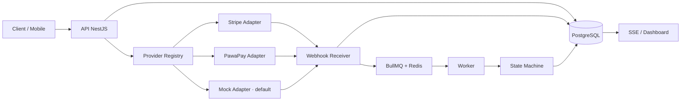
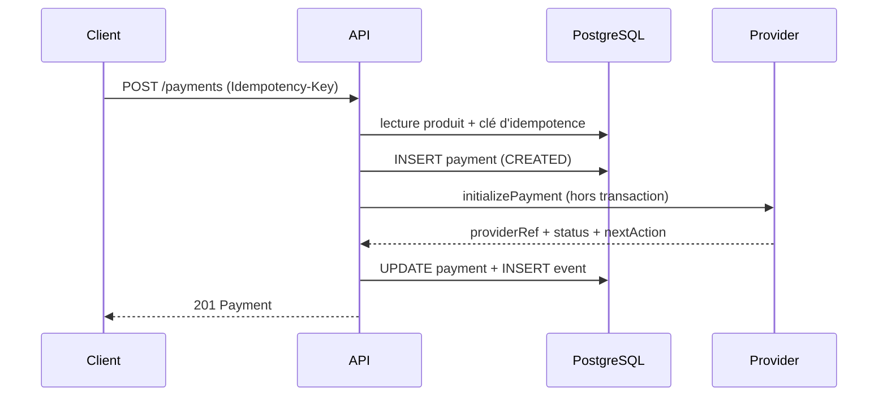
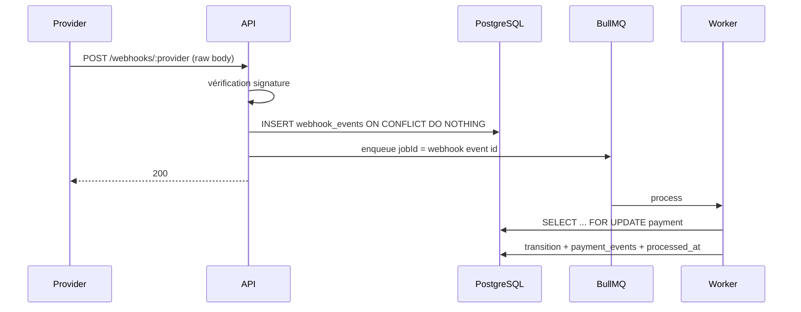

# ARCHITECTURE.md

## Contexte



## Containers

| Container  | Rôle                                                   |
| ---------- | ------------------------------------------------------ |
| `web`      | Next.js, checkout et dashboard                         |
| `api`      | HTTP, Swagger, création de paiement, ingestion webhook |
| `worker`   | BullMQ processors, sweeper, réconciliation, expiration |
| `postgres` | source de vérité ACID                                  |
| `redis`    | queues BullMQ et pub/sub                               |

Le worker est un process séparé, même image que l'API, commande différente.

## Modules API

```text
apps/api/src/
├── config/                 # env validé (Zod)
├── common/                 # guard clé démo, filters, pipes
├── infra/
│   ├── db/                 # schéma Drizzle, client, migrations, seed
│   └── queue/              # connexion BullMQ, noms de queues
├── modules/
│   ├── providers/          # contrat + registry + mock/stripe/pawapay
│   ├── payments/           # use-cases, repository, state machine
│   ├── webhooks/           # controller raw body + inbox + sweeper
│   ├── catalog/            # produits seedés
│   └── health/
└── workers/                # webhook processor, sweeper, reconciliation
```

## Flux de création



Règles :

- Le montant vient du produit en base.
- Aucun appel provider dans une transaction PostgreSQL.
- La clé d'idempotence stocke le hash de la requête et la réponse.

## Flux webhook



Le handler HTTP ne fait aucune logique métier. Si Redis tombe après l'insert,
le sweeper reprend les lignes non traitées.

Signatures par provider :

- Mock : HMAC-SHA256 sur `timestamp.body`, fenêtre de 5 minutes.
- Stripe : `Stripe-Signature` validée par le SDK officiel.
- PawaPay : RFC 9421 ECDSA P-256, `Content-Digest`, `Signature-Date`,
  `created`/`expires`, clé publique récupérée via `/v2/public-key/http`.
- Les événements non pertinents sont acquittés en `200` et ignorés.

## State machine

| Depuis               | Vers                                                                          |
| -------------------- | ----------------------------------------------------------------------------- |
| `CREATED`            | `PENDING`, `REQUIRES_ACTION`, `PROCESSING`, `FAILED`, `EXPIRED`, `CANCELED`   |
| `PENDING`            | `REQUIRES_ACTION`, `PROCESSING`, `SUCCEEDED`, `FAILED`, `EXPIRED`, `CANCELED` |
| `REQUIRES_ACTION`    | `PENDING`, `PROCESSING`, `SUCCEEDED`, `FAILED`, `EXPIRED`, `CANCELED`         |
| `PROCESSING`         | `SUCCEEDED`, `FAILED`, `EXPIRED`                                              |
| `SUCCEEDED`          | `REFUND_PENDING`, `PARTIALLY_REFUNDED`, `REFUNDED`                            |
| `REFUND_PENDING`     | `SUCCEEDED`, `PARTIALLY_REFUNDED`, `REFUNDED`                                 |
| `PARTIALLY_REFUNDED` | `REFUND_PENDING`, `REFUNDED`                                                  |

États sans sortie : `FAILED`, `EXPIRED`, `CANCELED`, `REFUNDED`.
La table est la source de vérité dans `packages/contracts`.

## Données

- `products` : catalogue serveur, prix en unités mineures.
- `payments` : agrégat, statut courant, `version`, `last_event_at`.
- `payment_events` : journal append-only, séquence par paiement.
- `webhook_events` : inbox brute, unicité `(provider, provider_event_id)`.
- `idempotency_keys` : hash de requête + réponse stockée.

UUIDv7 généré côté application (`$defaultFn`), pour rester portable sur les
Postgres managés. Montants en `bigint` et exposés en string dans l'API.

## Concurrence et ordre

- `SELECT … FOR UPDATE` sur la ligne `payments` avant transition.
- Webhook déjà traité → no-op.
- Transition identique → no-op idempotent.
- Transition arrière → événement marqué ignoré, pas d'écrasement.
- En cas de conflit avec le provider, réconciliation via `getPayment`.
- Le worker réconcilie toutes les 60 s les paiements Stripe/PawaPay bloqués
  depuis plus de 2 minutes, hors transaction DB.
- `jobId` BullMQ = id du webhook, mais la vérité reste la contrainte SQL.

## Stripe

- Checkout Session hébergée, mode `payment`, `client_reference_id` = payment id.
- `metadata.paymentId` et `payment_intent_data.metadata.paymentId` posés à la
  création pour corréler les webhooks.
- Événements traités : `checkout.session.completed`,
  `async_payment_succeeded` / `failed`, `checkout.session.expired`,
  `payment_intent.succeeded` / `payment_failed` / `canceled`.
- Un paiement non payé à la complétion passe en `PROCESSING`, puis le webhook
  asynchrone final tranche.
- Aucune donnée carte côté API : Stripe Checkout héberge les champs.
- `refund()` appelle l'API Refunds avec une clé d'idempotence ; l'endpoint HTTP
  de refund et ses callbacks sont prévus en Phase 2b.

## PawaPay

- API v2 sandbox : `https://api.sandbox.pawapay.io/`.
- `depositId` UUIDv4 généré côté application, stocké comme `providerRef`.
- `clientReferenceId` = payment id pour la corrélation.
- Callback uniquement sur statut final (`COMPLETED`, `FAILED`) → la
  réconciliation est obligatoire.
- Signatures RFC 9421 (`Signature`, `Signature-Input`, `Signature-Date`,
  `Content-Digest`), ECDSA P-256, clé publique via `/v2/public-key/http`.
- Vérifier `@authority` et `@path` derrière un reverse proxy.
- `PAWAPAY_ALLOW_UNSIGNED_CALLBACKS=true` est un fallback local explicite,
  interdit en production.
- La signature des requêtes sortantes (« Only accept signed requests ») n'est
  pas activée : laisser l'option désactivée côté dashboard.
- Numéros de test sandbox documentés par PawaPay (ex. `221773456789`).

## Sécurité

- Aucun PAN côté API : Stripe Checkout ou Payment Element.
- Signatures en temps constant, fenêtre anti-replay.
- PawaPay : vérification RFC 9421 + digest + fenêtre temporelle.
- Raw body conservé pour audit.
- Clés provider chargées uniquement côté serveur ; jamais dans `NEXT_PUBLIC_*`.
- Clé de démo sur les mutations, rate limiting à ajouter en Phase 3.
- Secrets uniquement en variables d'environnement.
- Redaction des emails/téléphones dans les logs.

## Swagger

Disponible sur `GET /docs`. Chaque controller expose ses tags, chaque DTO ses
`@ApiProperty`, chaque endpoint ses réponses et ses en-têtes (dont
`Idempotency-Key` et `x-demo-key`). Toute évolution de contrat doit être
répercutée dans Swagger et dans `packages/contracts`.

## Décisions

- ADR 0001 : monorepo pnpm + Turborepo.
- ADR 0002 : inbox PostgreSQL avant BullMQ.
- ADR 0003 : Mock comme chemin par défaut.
- State machine explicite plutôt que XState côté serveur.
- `class-validator` côté API pour rester compatible Nest 12 + Swagger 12 ;
  Zod pour la configuration d'environnement.

## Web checkout

- Routes localisées `/:locale/shop`, `/:locale/product/:slug`,
  `/:locale/checkout`, `/:locale/checkout/:paymentId`.
- `next-intl` + `proxy.ts` : `fr` par défaut, `en` disponible, retour Stripe
  `/checkout/:id` redirigé vers la route localisée.
- Server Components pour le catalogue et les fiches produit via
  `API_INTERNAL_URL` ; le navigateur garde `NEXT_PUBLIC_API_URL`.
- Le provider est résolu côté web depuis la méthode, la devise et
  `/providers` ; l'acheteur ne voit jamais `provider` ni `rail`.
- Le checkout envoie l'adresse de livraison dans `metadata.shippingAddress` en
  attendant un agrégat `Order`. Aucun calcul de livraison ou de taxe n'est
  inventé.
- Les montants affichés sont toujours des unités mineures formatées par
  `Intl.NumberFormat` ; le serveur reste la seule source de vérité.
- Le résultat acheteur est séparé du dashboard technique. Les events, webhooks
  et le state machine vivent dans le drawer « Under the hood ».
- SSE se reconnecte avec backoff ; le polling s'arrête sur statut réglé.

## État actuel

- Phase 0 : fondations.
- Phase 1 : walking skeleton Mock, checkout, dashboard, Swagger.
- Phase 2 : adaptateurs Stripe Checkout et PawaPay deposits, webhooks signés,
  capabilities providers, réconciliation des paiements bloqués.
- Phase 2b : endpoint/UI de refunds, callbacks refunds, tests de contrat sandbox.
- Phase 3 : DLQ + replay, expiration, tests Testcontainers, rate limiting.
